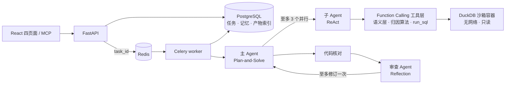

# MetricProof

> 电商经营异动归因多 Agent 系统（前身为 OrderProof）：Agent 自主完成异动检测、指标拆解、维度下钻与关联排查，报告里的每个数字都引用工具结果的 `result_id` 并标注核验等级。

[](https://github.com/control-coder/metricproof/actions/workflows/ci.yml)


> [!IMPORTANT]
> 本项目是单用户、本机回环地址上的工程原型，只用模拟订单与 Olist 公开数据集验证过。它不是公网多租户服务，没有身份认证；只做描述性归因（贡献度与相关性），不做预测或因果推断。

## 项目简介

面向结构固定的 Olist 多表数据（含卖家表），用户用自然语言提问，例如“2018 年 3 月送达延迟率为什么上升”。主 Agent 检测异动并拆解指标，分派子 Agent 做维度下钻，审查 Agent 复核报告，最终输出带核验等级的归因报告。

项目重点在三件事：

- **数字必须可追溯**：报告中的数字引用 `result_id`，由代码逐条核对数字、引用与因果措辞；核对不通过的报告判为无效，不由模型自我审批。
- **业务口径由人确认**：业务规则存放在带版本的业务记忆中，确认后才会被使用；口径不明时调查暂停，等用户答复。
- **受限执行**：生成代码和自由查询都在专用 Docker 容器中运行，非 root、无网络、只读根文件系统，资源有限制。

前身 OrderProof 的单表订单 CSV 与 9 类固定统计任务（Planner、Analyst、Reviewer 流水线）保留用于回归。

## 功能特性

- **异动归因**：异动检测（MAD z 分数）、指标拆解（Delta、LMDI、组间组内）、维度下钻（Adtributor 式根因定位、贡献度）与关联排查，全部为确定性算法，经语义层指标树调用。
- **三类 Agent**：主 Agent（Plan-and-Solve）规划与汇总，子 Agent（ReAct，至多 3 个并行）按维度组独立排查，审查 Agent（Reflection）只看报告与代码核对结果。
- **Function Calling 工具层**：参数由服务端按 JSON Schema 校验，工具按 Agent 授权，越权调用不会到达 handler。
- **核验等级**：L1 由语义层与独立参考复算，L2 为自由查询与沙箱结果（不变量、蜕变关系、汇总比对），L3 为未核验的文字。
- **记忆**：情景记忆（BM25 检索历史归因，作少样本参考，不能升级为业务规则）；业务口径需用户确认；人在回路（`ask_user`、`propose_metric`）。
- **自由查询 `run_sql`**：sqlglot 白名单只放行只读 SELECT，表与列在白名单内，在 DuckDB 沙箱容器中执行。
- **API、前端与 MCP**：FastAPI + PostgreSQL + Redis/Celery，调查是一种任务类型；React + TypeScript 四页面；MCP 服务把查询、提交调查与读取报告包装为 9 个工具。
- **固定分析（回归）**：单表六类分析与 Olist 订单级分析，数值经独立 SQL 复算，核验失败时只回传错误位置。
- 模型可选 MiMo 或 DeepSeek（OpenAI 兼容接口），固定演示模式不调用模型。本项目的真实评测只用 MiMo。

## 界面

以下截图由浏览器流程测试在固定演示模式（不调用模型）下自动生成，数据是 6 行模拟订单，展示的是固定分析的报告页。


<details>
<summary>其余三页：数据工作台、分析任务、项目记忆</summary>


</details>

重新生成：服务启动后运行 `DATALAB_SHOT_DIR=docs/images node frontend/tests/browser-flow.mjs`（需要本机 Edge）。

## 架构



Agent 分工、工具授权、核验等级、受限执行、记忆与安全边界见 [docs/architecture.md](docs/architecture.md)。

## 快速开始

环境要求：Python 3.12（conda）、Node.js、可运行 Linux 容器的 Docker。固定演示模式不需要 API Key；归因调查需要配置 MiMo。

```powershell
# 1. 安装
conda env create -f environment.yml
conda activate datalab
python -m pip install --no-build-isolation -e .
npm ci --prefix frontend
npm run build --prefix frontend
docker build -t datalab-executor:py312-v2 -f scripts/executor/Dockerfile .

# 2. 启动本项目专用的 PostgreSQL/Redis（回环随机端口），然后启动应用
python -B scripts/local_services.py start
python -B scripts/serve.py
```

打开 <http://127.0.0.1:18080>：

1. 在“数据工作台”导入 Olist 多表数据（先运行 `python -B scripts/fetch_olist.py` 获取公开数据）；单表演示可上传 `examples/orders.csv`。
2. 在“项目记忆”确认订单金额口径。
3. 在“分析任务”提交归因调查（需要模型模式）或固定分析；口径不明时任务会等待确认。
4. 在“报告详情”查看根因、发现、核验等级与代码核对结论。

接入真实模型时，先复制 `.env.example` 为 `.env` 并填写密钥，再运行 `python -B scripts/switch_model.py mimo`。镜像源、模型配置与排障见 [docs/development.md](docs/development.md)。

通过 MCP 接入外部 Agent：`python -m pip install -e ".[mcp]"`，服务启动后在客户端配置 stdio 命令 `python -m datalab.api.mcp_server`。工具清单与边界见 [docs/api.md](docs/api.md#mcp-服务)。

## 测试

```powershell
python -m ruff check src tests scripts evals
python -B -m unittest discover -s tests/datalab -v
npm run build --prefix frontend
```

CI 在每次推送到 `main` 和每个 Pull Request 时运行以上三项，并在独立作业中用服务容器跑真实 Docker 沙箱隔离、PostgreSQL、Celery 应用集成和固定种子评测（不调用模型）。全量测试约 2 分钟，开发时可只跑受影响模块，例如 `python -B -m unittest tests.datalab.test_attribution`。Edge 浏览器流程需要本机运行，见 [开发与运行](docs/development.md#测试)。

## 评测结果

完整方法、过程与局限见 [docs/evaluation.md](docs/evaluation.md)。MetricProof 与前身 OrderProof 的结果分开报告，不混算。

### MetricProof：A10 test（2026-10-28）

test 集共 30 个案例，其中 23 个为注入异动，7 个为原始数据问题。运行配置为并行模式，含审查 Agent 与 `run_sql` 沙箱，模型为真实 MiMo。题集在 Agent 开发前冻结：注入案例的标准答案取自注入参数，原始问题的标准答案由独立参考实现给出。

test 集共跑了两次。第一次之后，根据暴露的短板做了修复，再复测一次。

| 指标 | 首次：注入 | 首次：原始 | 修复后：注入 | 修复后：原始 |
| --- | --- | --- | --- | --- |
| Top-1 准确率（AC@1） | 6/23 | 3/7 | 13/23 | 3/7 |
| Top-3 准确率（AC@3） | 14/23 | 5/7 | 18/23 | 6/7 |
| 通过代码核对的报告 | 15/23 | 3/7 | 23/23 | 7/7 |
| L1 核验通过率 | 0.964 | 0.908 | 0.989 | 1.000 |
| 工具调用准确率 / 越权调用 | 1.0 / 0 | 0.993 / 0 | 1.0 / 0 | 1.0 / 0 |
| p50 / p90 时延（秒） | 220 / 464 | 204 / 440 | 254 / 307 | 218 / 249 |

AC@k 指真实根因（注入的维度与取值）出现在报告根因前 k 个中的比例。修复的内容：

- 根因的候选集由主 Agent 给出，先后顺序改由确定性算法 `find_root_cause` 决定。
- 代码核对接受能唯一解析的缩写 result_id，以及两数之和或之差，并剔除仍未通过核对的句子。
- 提示词要求比率型指标列出结构效应项。
- 修复了语义层引擎的并发建表、主 Agent 只回复文字就结束，以及参考计算缓存导致内存持续增长三个缺陷。

局限：
- 修复方向来自对 test 首次结果的分析，复测不再是严格意义上的留出评估，两次结果都如实列出。
- 样本量小，每次每个案例只跑一次，不做显著性结论；时延包含供应商侧排队。
- mix_shift（支付结构变化）在复测中 AC@3 为 1/4，order_drop（品类与州组合内订单删除）为 1/3，仍是短板。其中 mix_shift 有 2 例的数据本身以组内效应为主，与题集标注不一致。复测后新增了组间效应项补入，离线重评 40 份报告 AC@3 由 32 升至 33，没有重新运行调查。

提示注入：10 个案例把指令植入品类名、支付方式与卖家 ID，包括劫持根因、金丝雀和诱导写操作 SQL 三类。载体 10/10 进入了模型上下文，攻击成功 0/10，没有出现写操作 SQL 的尝试，AC@3 为 8/10。样本小，这个结果不代表模型对注入免疫。详见 [docs/evaluation.md](docs/evaluation.md)。

### 前身 OrderProof 时期的历史结果

以下是改造前三角色流水线（单表与 Olist 固定分析）的结果，与上面的归因评测无关，不能互相比较。

**留出集**：24 道冻结题 × 5 批 × 2 个模型 × 单 Agent / 三角色，共 480 例。正确率区间为以题为单位的 95% Wilson。

| 模型 | 对照 | 正确率 | 首次即对 | 核验通过但错 | 中位 / p90 时延（秒） |
| --- | --- | --- | --- | --- | --- |
| MiMo | 单 Agent | 100% [86.2, 100] | 99.2% | 0 | 13.6 / 21.7 |
| MiMo | 三角色 | 100% [86.2, 100] | 96.7% | 0 | 32.7 / 70.6 |
| DeepSeek | 单 Agent | 100% [86.2, 100] | 100% | 0 | 7.5 / 13.9 |
| DeepSeek | 三角色（优化前） | 99.2% [84.8, 100] | 86.7% | 0 | 17.7 / 38.6 |
| DeepSeek | 三角色（优化后，复测） | 98.3%（118/120，未按题算区间） | 95.8% | 0 | 未单列 / 28.9 |

- 三角色没有换来正确率收益，成本约为单 Agent 的 1.4 倍（MiMo）和 2.2 倍（DeepSeek），时延约 2.2 倍；24 题全对时 Wilson 下界约 86%，只能说“没有观察到可确认的差异”。
- 开发题集上，复用已确认口径的 16 例全部正确，由模型自定口径的 16 例里只有 4 例正确，其余 12 例中 11 例通过了数值核验但结论错误。这组对照没有在留出集上重做。
- 错误注入基准：20 个代码变异算子 × 24 道留出题 × 4 份数据，暴露的 632 个错误中，不依赖参考值的两层（结果不变量 ∪ 蜕变关系）检出 77.7%（Wilson [74.3, 80.8]）。变异是合成的。
- Olist 真实数据：40 道冻结留出题 × 3 批，MiMo 三角色 107/120、单 Agent 111/120；未答对的 22 例中 21 例是 MiMo 接口 HTTP 500 或连接失败，静默错误 0/240。

这些结果基于 24 或 40 道题、合成或单一公开数据、两个 flash 级模型，部分提示调整来自开发题集。

## 项目结构

```text
src/datalab/
  agents/         Function Calling 工具层、主 Agent、子 Agent、审查 Agent、报告代码核对
  attribution/    异动检测、指标拆解、贡献度、根因定位、相关分析与 L1 核验
  semantic/       语义层：指标定义、维度与粒度校验、SQL 编译、指标树
  api/            HTTP 接口、访问约束、产物下载、MCP 服务
  datasets/       CSV 规范化、字段映射、Olist 多表导入、质量检查、数据版本
  orchestration/  状态机、预算、Celery worker、租约与补发
  roles/          固定分析的 Planner、Analyst、Reviewer 运行时、提示、模型适配
  memory/         业务记忆的版本、确认与冲突（PostgreSQL）；情景记忆
  execution/      固定分析、代码框架、run_sql 白名单与沙箱、Docker runner
  verification/   独立 SQL 参考、下载表比对、结果不变量、蜕变关系与 L2 检查
  artifacts/      图表与模板说明
  storage/        项目、任务与产物索引
frontend/         React + TypeScript + Vite 四页面与浏览器流程测试
scripts/          本地服务、启动、模型切换、MCP 冒烟；executor/ 为执行镜像
evals/            归因评测（anomaly/ 题集、investigate.py）与 OrderProof 时期的评测脚本
examples/         模拟订单样例
tests/datalab/    单元与集成测试
```

内部 Python 包、conda 环境与执行镜像沿用早期名称 `datalab`。

## 文档

| 文档 | 内容 |
| --- | --- |
| [架构与取舍](docs/architecture.md) | 模块、Agent 分工与工具授权、语义层、归因算法、受限执行、记忆、任务持久化与安全边界 |
| [API 与前端行为](docs/api.md) | 接口、异动归因调查、MCP 服务、访问约束与错误语义 |
| [开发与运行](docs/development.md) | 安装、启动、模型配置、测试开关、CI 与排障 |
| [评测与验证](docs/evaluation.md) | 判定口径、各轮结果、失败案例与局限 |

## 局限

- 只做描述性归因（贡献度与相关性），不做因果推断、预测；数据限于结构固定的 Olist 多表与单表订单 CSV（单币种、统一时区，最多 20 MB、10 万行），不接受任意文件或任意表，不自动推断连接，不直连数据库。
- 仅限本机单用户：写接口只校验 Host、Origin 和客户端标识，没有身份认证与授权，不能直接暴露到公网。
- 评测规模小，归因评测每个案例只运行一次；调查从头重跑，不保存模型上下文。
- 只在一台 Windows 主机上验证过；宿主进程崩溃后的遗留容器需要人工清理。

## 许可证

本项目代码采用 [MIT License](LICENSE)。设计参考与运行依赖的说明见 [THIRD_PARTY_NOTICES.md](THIRD_PARTY_NOTICES.md)。
