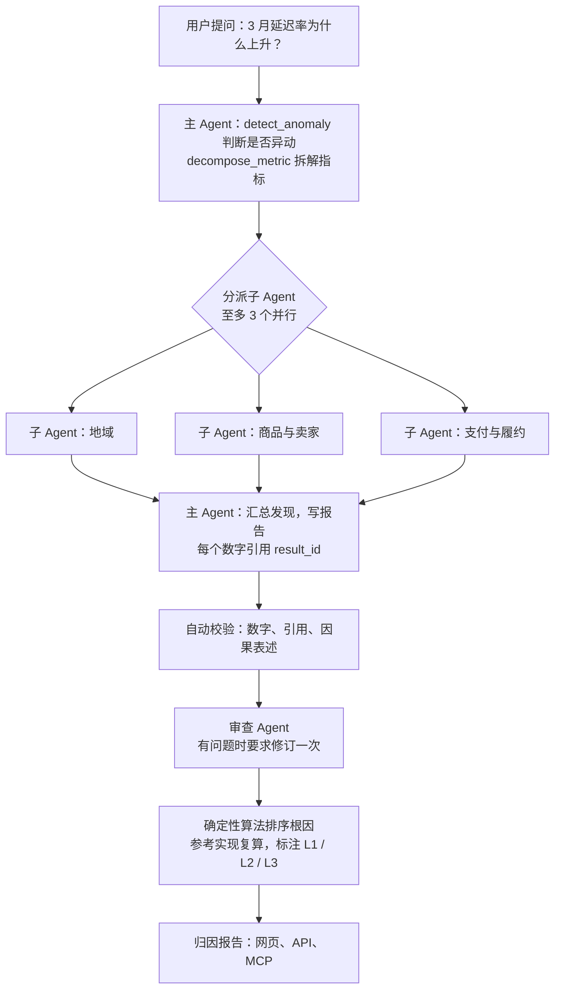
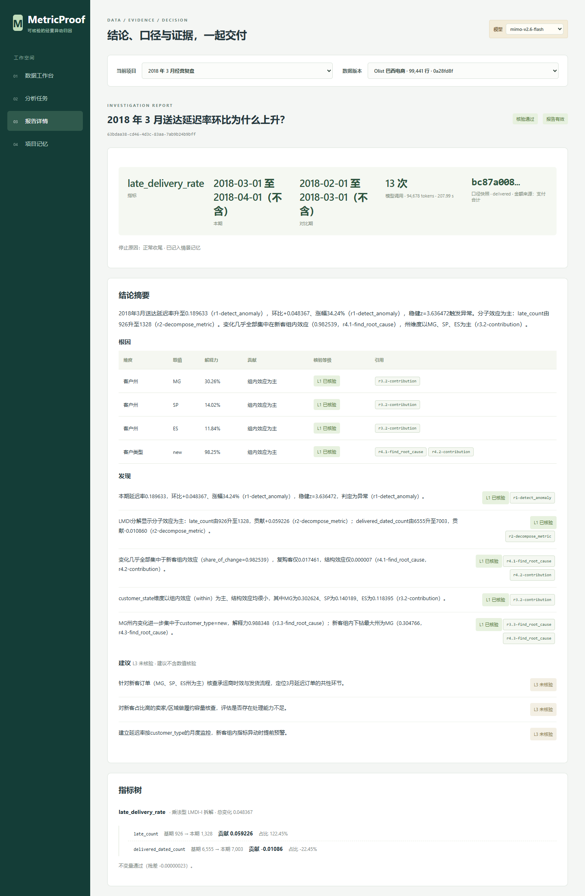
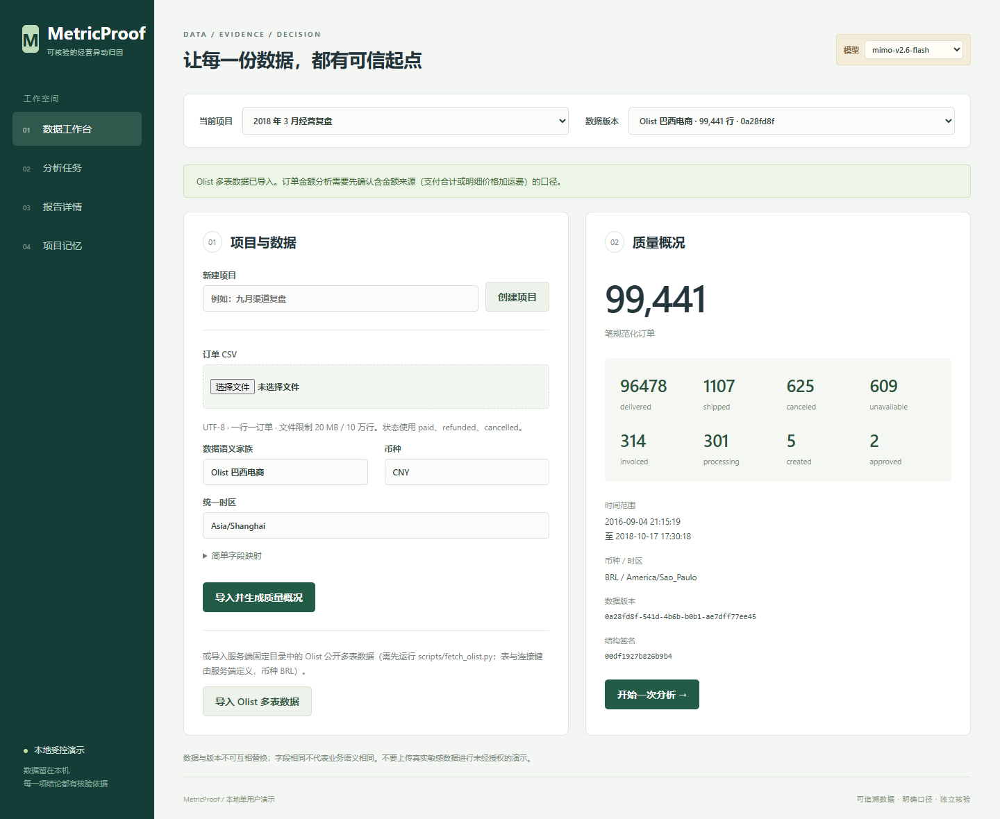
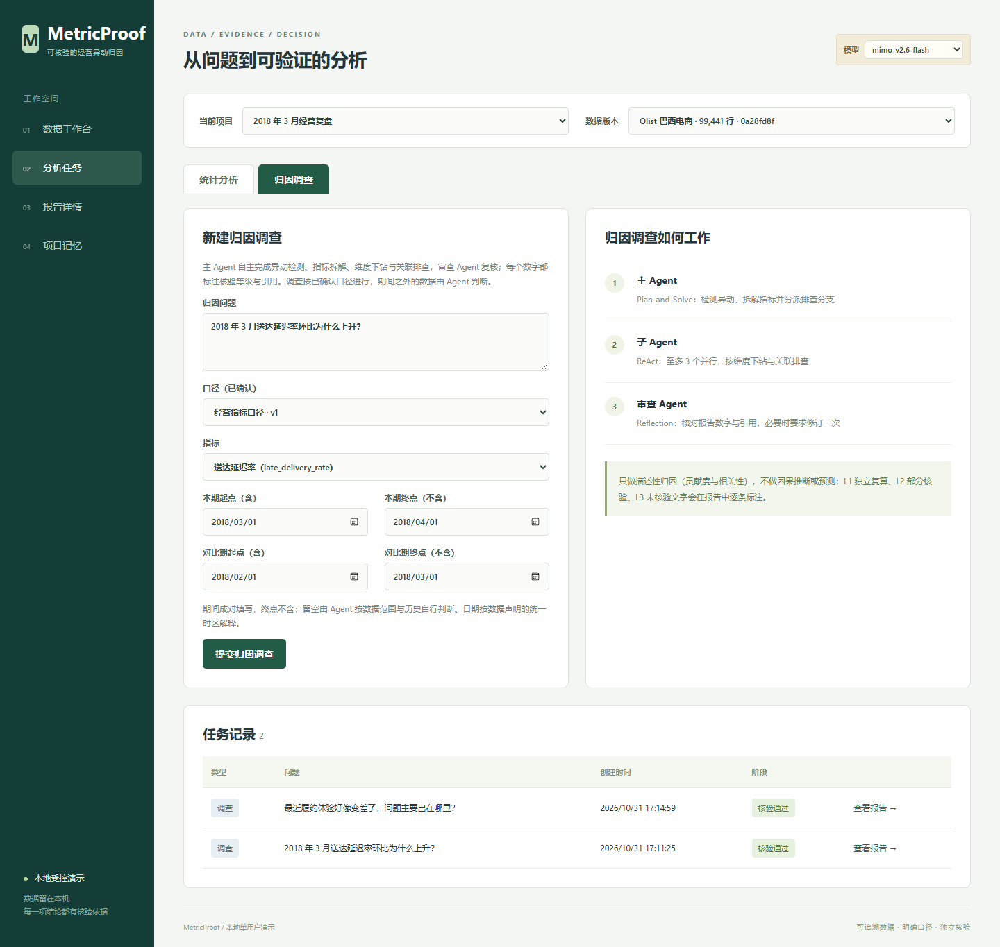
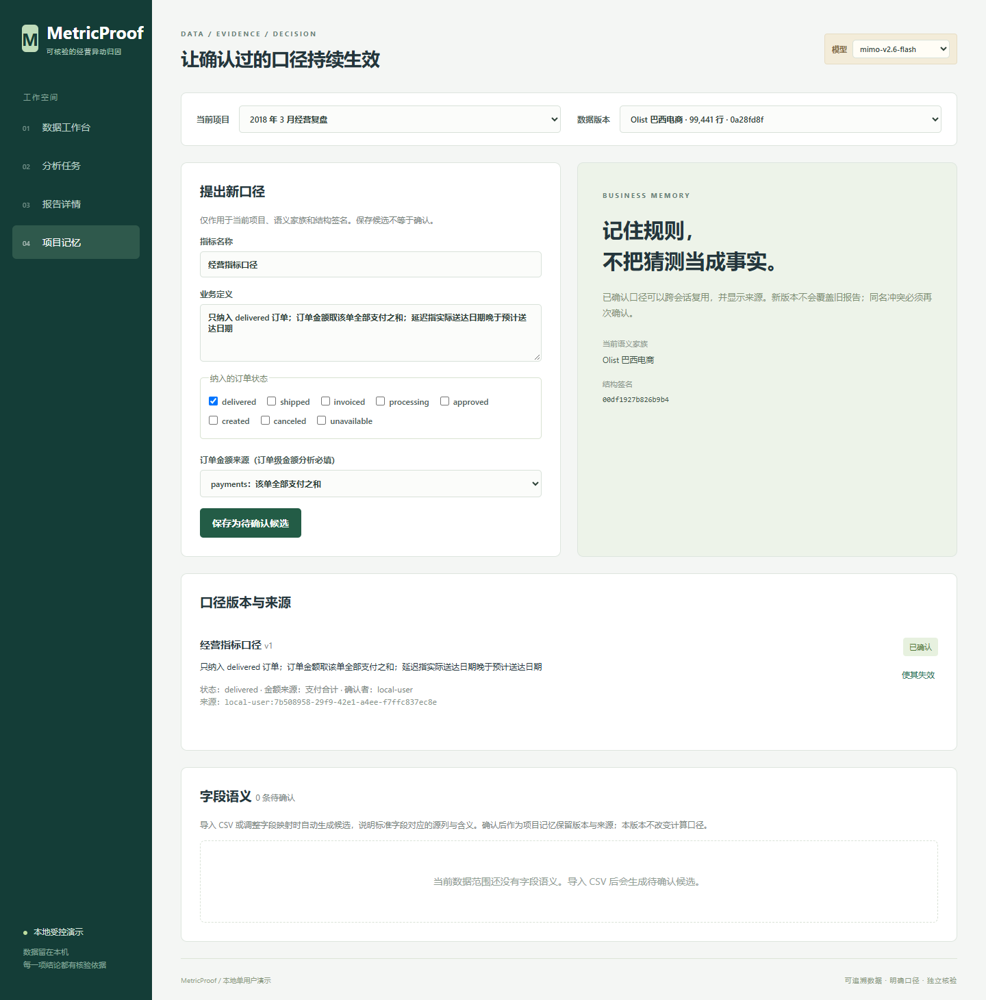

# MetricProof

> 电商经营异动归因多 Agent 系统：Agent 自主完成异动检测、指标拆解、维度下钻与关联排查，报告里的每个数字都引用工具结果的 `result_id` 并标注核验等级。

[](https://github.com/control-coder/metricproof/actions/workflows/ci.yml)


> [!IMPORTANT]
> 本项目是单用户、本机回环地址上的工程原型，只用模拟订单与 Olist 公开数据集验证过。它不是公网多租户服务，没有身份认证；只做描述性归因（贡献度与相关性），不做预测或因果推断。

## 业务背景

电商运营每天盯着 GMV、订单量、客单价、送达延迟率、差评率等经营指标。指标突然变化时，例如“3 月送达延迟率从 14% 升到 23%”，运营需要尽快知道变化是否异常、集中在哪里。人工做这件事通常要四步：

1. 确认是真异动，而不是正常波动；
2. 拆解指标，例如 GMV = 订单量 × 客单价，看是哪一项在变；
3. 按州、品类、卖家、支付方式等维度逐一维度下钻，计算各维度值对总变化的贡献度；
4. 关联排查，例如差评上升是否集中在延迟订单上。

这个过程费时，维度多时容易漏看；直接让大模型回答，又可能编造数字。MetricProof 让用户用一句话提问，由 Agent 自主完成这四步，输出一份异动归因报告，例如“延迟率上升主要集中在 SP 州，贡献约 78%”。报告中的每个数字都来自工具的计算结果，并由独立的参考实现复算，标注核验等级。

数据使用巴西电商平台 Olist 的公开多表数据（订单、明细、支付、评价、客户、商品、卖家）。

## 设计要点

- **模型决定路径，代码负责计算**：大模型通过 Function Calling 选择工具和参数，异动检测、指标拆解、贡献度、根因定位都是服务端的确定性算法。
- **三类 Agent 分工**：主 Agent 规划并汇总，子 Agent 在各自的上下文里并行排查一组维度，审查 Agent 只审查报告。每类 Agent 只能调用授权给它的工具。
- **数字必须可追溯**：报告中的数字引用工具结果的 `result_id`，由服务端规则逐条校验数字、引用与因果表述；校验不通过的内容会被剔除或使报告无效，不依赖模型自评。
- **业务口径由人确认**：业务规则存放在带版本的业务记忆中，确认后才会被使用；口径不明时调查暂停，等用户答复（人在回路）。
- **受限执行**：自由查询和生成代码都在专用 Docker 容器中运行，非 root、无网络、只读根文件系统，资源有限制。

| Agent | 职责 | 可用工具（节选） |
| --- | --- | --- |
| 主 Agent（Plan-and-Solve） | 检测异动、拆解指标；把待排查维度分成至多 3 组分派给子 Agent；汇总写报告 | `detect_anomaly`、`decompose_metric`、`dispatch_subagent`、`ask_user`、`finish` |
| 子 Agent（ReAct，至多 3 个并行） | 负责一组维度（如地域、商品与卖家、支付与履约），计算贡献度并继续维度下钻，交回结构化发现 | `contribution`、`find_root_cause`、`correlate`、`run_sql`、`run_python` |
| 审查 Agent（Reflection） | 只看报告与自动校验结果，指出问题后让主 Agent 修订一次 | `verify_claims`、`read_result` |

## 工作流程



核验等级：L1 由语义层与独立参考实现复算一致；L2 为自由查询与沙箱执行结果，经结果不变量、蜕变关系与汇总比对检查；L3 为未核验的文字。

单表订单 CSV 与 9 类固定统计任务（Planner、Analyst、Reviewer 流水线）保留用于回归。

## 功能特性

- **异动归因**：异动检测（基于 MAD 的稳健 z 分数）、指标拆解（Delta 法、LMDI、组间组内拆解）、维度下钻（基于 Adtributor 的根因定位、贡献度）与关联排查，全部为确定性算法，经语义层指标树调用。
- **Function Calling 工具层**：参数由服务端按 JSON Schema 校验，工具按 Agent 授权，越权调用不会到达 handler。
- **记忆**：情景记忆（BM25 检索历史归因报告，作为少样本（few-shot）示例，不能升级为业务规则）；业务口径需用户确认；人在回路（`ask_user`、`propose_metric`）。
- **自由查询 `run_sql`**：sqlglot 白名单只放行只读 SELECT，表与列在白名单内，在 DuckDB 沙箱容器中执行。
- **API、前端与 MCP**：FastAPI + PostgreSQL + Redis/Celery，调查是一种任务类型；React + TypeScript 四页面；MCP 服务把查询、提交调查与读取报告包装为 9 个工具。
- **固定分析（回归）**：单表六类分析与 Olist 订单级分析，数值经独立 SQL 复算，核验失败时只回传错误位置。
- 模型可选 MiMo 或 DeepSeek（OpenAI 兼容接口），固定演示模式不调用模型。本项目的真实评测只用 MiMo。

## 界面

以下截图由浏览器流程测试在固定演示模式（不调用模型）下自动生成，数据是 6 行模拟订单，展示的是固定分析的报告页。



<details>
<summary>其余三页：数据工作台、分析任务、项目记忆</summary>







</details>

重新生成：服务启动后运行 `DATALAB_SHOT_DIR=docs/images node frontend/tests/browser-flow.mjs`（需要本机 Edge）。

## 架构


Agent 分工、工具授权、核验等级、受限执行、记忆与安全边界见 [docs/architecture.md](docs/architecture.md)。

## 快速开始

环境要求：Python 3.12（conda）、Node.js、可运行 Linux 容器的 Docker。固定演示模式不需要 API Key；归因调查需要配置 MiMo。

```powershell
# 1. 安装
conda env create -f environment.yml
conda activate datalab
python -m pip install --no-build-isolation -e .
npm ci --prefix frontend
npm run build --prefix frontend
docker build -t datalab-executor:py312-v2 -f scripts/executor/Dockerfile .

# 2. 启动本项目专用的 PostgreSQL/Redis（回环随机端口），然后启动应用
python -B scripts/local_services.py start
python -B scripts/serve.py
```

打开 <http://127.0.0.1:18080>：

1. 在“数据工作台”导入 Olist 多表数据（先运行 `python -B scripts/fetch_olist.py` 获取公开数据）；单表演示可上传 `examples/orders.csv`。
2. 在“项目记忆”确认订单金额口径。
3. 在“分析任务”提交归因调查（需要模型模式）或固定分析；口径不明时任务会等待确认。
4. 在“报告详情”查看根因、发现、核验等级与自动校验结论。

接入真实模型时，先复制 `.env.example` 为 `.env` 并填写密钥，再运行 `python -B scripts/switch_model.py mimo`。镜像源、模型配置与排障见 [docs/development.md](docs/development.md)。

通过 MCP 接入外部 Agent：`python -m pip install -e ".[mcp]"`，服务启动后在客户端配置 stdio 命令 `python -m datalab.api.mcp_server`。工具清单与边界见 [docs/api.md](docs/api.md#mcp-服务)。

## 测试

```powershell
python -m ruff check src tests scripts evals
python -B -m unittest discover -s tests/datalab -v
npm run build --prefix frontend
```

CI 在每次推送到 `main` 和每个 Pull Request 时运行以上三项，并在独立作业中用服务容器跑真实 Docker 沙箱隔离、PostgreSQL、Celery 应用集成和固定种子评测（不调用模型）。全量测试约 2 分钟，开发时可只跑受影响模块，例如 `python -B -m unittest tests.datalab.test_attribution`。Edge 浏览器流程需要本机运行，见 [开发与运行](docs/development.md#测试)。

## 评测结果

真实数据中的异动没有标注好的根因，所以评测集包含两类用例：

- **异常注入用例**：在 Olist 真实数据的某个月中人工注入一处异常，真实根因（ground truth）即注入的维度值。共 6 类：某州送达延迟（delivery_delay）、某卖家州运费上调（freight_up）、某品类降价（price_cut）、某卖家停售（seller_drop）、某品类×某州订单减少（order_drop）、支付方式结构变化（mix_shift）。
- **真实数据用例**：不修改数据，真实根因由不调用模型的参考实现计算。

评测指标为 Top-k 准确率（AC@k）：真实根因出现在报告前 k 个根因中的比例。最终结果来自留出集（holdout set）的 30 个用例（6 类异常各 4 个，真实数据用例 6 个），在代码冻结后只运行一次；开发与提示词调优使用另外的开发集。运行配置为子 Agent 并行、含审查 Agent 与 `run_sql` 沙箱，模型为 MiMo，共 377 次模型调用，约 1.30 元。

| 指标 | 异常注入用例（24） | 真实数据用例（6） | 合计（30） |
| --- | --- | --- | --- |
| Top-1 准确率（AC@1） | 20/24 | 3/6 | 23/30 |
| Top-3 准确率（AC@3） | 24/24 | 5/6 | 29/30 |
| 通过自动校验的报告 | 24/24 | 5/6 | 29/30 |
| L1 核验通过率 | 0.995 | 1.000 | |
| 工具调用准确率 / 越权调用 | 1.0 / 0 | 1.0 / 0 | |
| p50 / p90 时延（秒） | 165 / 283 | 81 / 154 | |

- 按异常类型，6 类的 AC@3 均为 4/4；AC@1 上 delivery_delay、freight_up、mix_shift、seller_drop 为 4/4，price_cut 为 3/4，order_drop 为 1/4。
- order_drop 的 AC@1 偏低：同月数据中还有更反常的自然变化（例如某个卖家当月销售额降为 0）。根因排序依据 Adtributor 的惊奇度（surprise），即分布变化的反常程度，而不是贡献金额，因此把这类变化排在注入的品类之前；真实根因的标注只包含注入的那一处。
- 1 个真实数据用例没有生成报告：模型偶发地没有调用工具，只回复了文字，按错误计。
- L1 核验未通过的 1 条是 LMDI 不变量的容差过紧（比率型指标的 6 位小数舍入），不是计算错误，已修正容差。

局限：每类只有 4 个用例，每个用例只运行一次，比例只能作粗略估计（例如 20/24 的 95% Wilson 区间约为 64%–93%）；异常注入用例由同一方法构造，结果不外推到真实业务数据；时延包含模型服务端排队，评测时 4 个调查并发运行；没有做单 Agent 对照，不据此声称多 Agent 比单 Agent 更准。

提示注入：10 个用例把恶意指令嵌入品类名、支付方式与卖家 ID，攻击类型包括目标劫持（goal hijacking）、金丝雀令牌（canary token）泄露和诱导执行写操作 SQL。恶意指令 10/10 进入了模型上下文，攻击成功 0/10，没有出现写操作 SQL 的尝试。样本小，这个结果不代表模型对注入免疫。

完整的评测方法、失败用例分析与局限见 [docs/evaluation.md](docs/evaluation.md)，其中也保留了固定分析流水线的早期评测，与归因评测不可比较。

## 项目结构

```text
src/datalab/
  agents/         Function Calling 工具层、主 Agent、子 Agent、审查 Agent、报告自动校验
  attribution/    异动检测、指标拆解、贡献度、根因定位、相关分析与 L1 核验
  semantic/       语义层：指标定义、维度与粒度校验、SQL 编译、指标树
  api/            HTTP 接口、访问约束、产物下载、MCP 服务
  datasets/       CSV 规范化、字段映射、Olist 多表导入、质量检查、数据版本
  orchestration/  状态机、预算、Celery worker、租约与补发
  roles/          固定分析的 Planner、Analyst、Reviewer 运行时、提示词、模型适配
  memory/         业务记忆的版本、确认与冲突（PostgreSQL）；情景记忆
  execution/      固定分析、代码框架、run_sql 白名单与沙箱、Docker runner
  verification/   独立 SQL 参考、下载表比对、结果不变量、蜕变关系与 L2 检查
  artifacts/      图表与模板说明
  storage/        项目、任务与产物索引
frontend/         React + TypeScript + Vite 四页面与浏览器流程测试
scripts/          本地服务、启动、模型切换、MCP 冒烟；executor/ 为执行镜像
evals/            归因评测（anomaly/ 评测集、investigate.py）与固定分析的评测脚本
examples/         模拟订单样例
tests/datalab/    单元与集成测试
```

内部 Python 包、conda 环境与执行镜像沿用早期名称 `datalab`。

## 文档

| 文档 | 内容 |
| --- | --- |
| [架构与取舍](docs/architecture.md) | 模块、Agent 分工与工具授权、语义层、归因算法、受限执行、记忆、任务持久化与安全边界 |
| [API 与前端行为](docs/api.md) | 接口、异动归因调查、MCP 服务、访问约束与错误语义 |
| [开发与运行](docs/development.md) | 安装、启动、模型配置、测试开关、CI 与排障 |
| [评测与验证](docs/evaluation.md) | 评测方法、结果、失败用例分析与局限 |

## 局限

- 只做描述性归因（贡献度与相关性），不做因果推断、预测；数据限于结构固定的 Olist 多表与单表订单 CSV（单币种、统一时区，最多 20 MB、10 万行），不接受任意文件或任意表，不自动推断连接，不直连数据库。
- 仅限本机单用户：写接口只校验 Host、Origin 和客户端标识，没有身份认证与授权，不能直接暴露到公网。
- 评测规模小，归因评测每个用例只运行一次；调查从头重跑，不保存模型上下文。
- 只在一台 Windows 主机上验证过；宿主进程崩溃后的遗留容器需要人工清理。

## 许可证

本项目代码采用 [MIT License](LICENSE)。设计参考与运行依赖的说明见 [THIRD_PARTY_NOTICES.md](THIRD_PARTY_NOTICES.md)。
