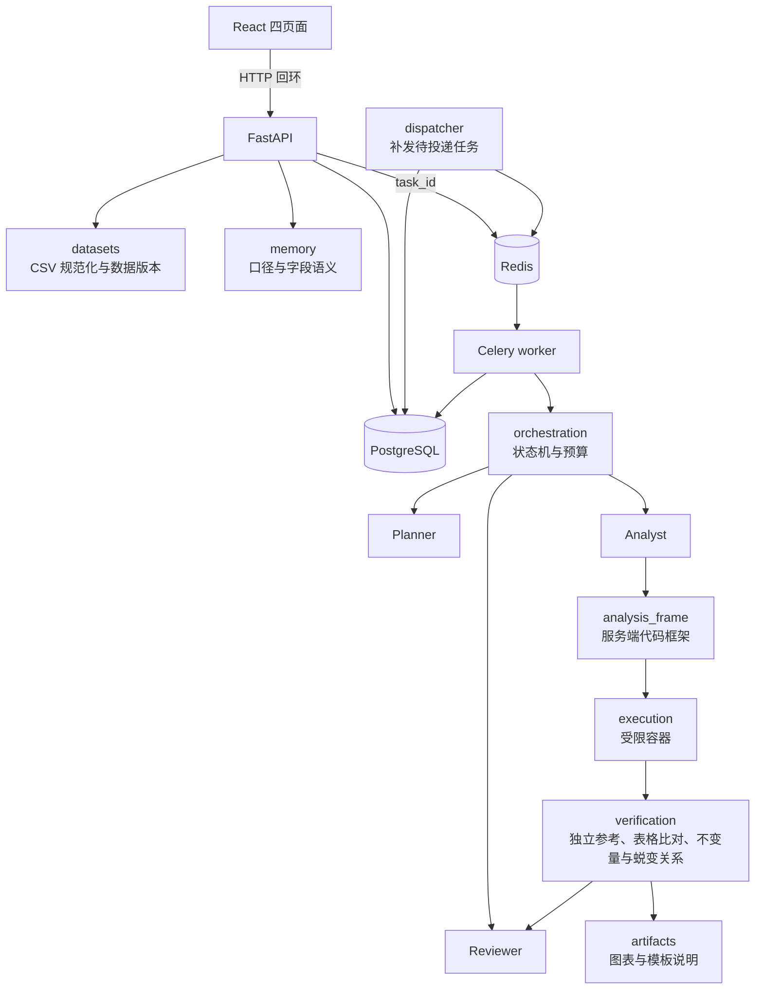
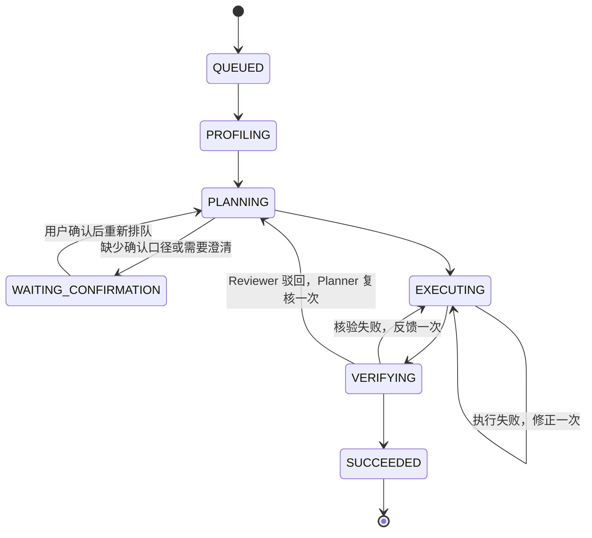

# 架构与取舍

OrderProof 是模块化单体：FastAPI 接口、Celery worker 与领域工作流在同一个 Python 包 `datalab` 中，按职责分模块，不拆微服务。PostgreSQL 是数据版本、业务记忆、任务状态与产物索引的唯一权威；Redis 只携带任务 ID；生成的分析代码只在专用的无网络 Docker 容器中执行。

## 模块

| 模块 | 职责 |
| --- | --- |
| `api/` | HTTP 接口、请求体上限、Host 与写入来源校验、产物下载 |
| `datasets/` | 标准 CSV 模板与字段映射、Olist 多表导入、质量检查、数据版本与 schema 签名 |
| `orchestration/` | 任务状态机、有界修正、Celery worker、租约与补发 |
| `roles/` | 三角色运行时与工具白名单、固定演示后端、OpenAI 兼容模型适配与提示 |
| `memory/` | 业务记忆的范围、版本、确认、失效与冲突，PostgreSQL 实现 |
| `execution/` | 六类固定分析、代码框架组装、Docker runner 与容器内收集器 |
| `verification/` | 独立 SQL 参考复算与下载表比对；不依赖参考值的结果不变量、蜕变关系，以及第二份纯 Python 参考 |
| `artifacts/` | 核验通过后的确定性图表与模板化说明 |
| `storage/` | 项目、数据集、任务快照与产物索引 |

业务范围（第一版）：UTF-8 CSV，一行一笔订单，字段为订单编号、支付时间、金额、状态、渠道、品类；单文件最多 20 MB、10 万行；单币种、统一时区，不支持部分退款。分析类型为汇总（summary）、趋势（trend）、排行（ranking）、占比（share）、期间对比（comparison）与数据质量（quality）。

第二版加入结构固定的 Olist 多表数据（下节）：表、列与连接键由服务端定义，分析代码只按这些连接键关联，模型和请求都不能指定表、列或连接方式。仍然不做任意 Excel/PDF 或任意表、自动推断连接、联网、数据库直连、预测、机器学习建模或因果推断；分组说明只是描述性分解。

### 多表数据（Olist）

除单表 `orders` 外，数据版本可以是结构固定的 Olist 多表 `olist`（`datasets/olist.py`）。表、列、类型与连接键全部由服务端定义，只从固定目录读取七个已知文件名，不接受任意表或列；结构签名由这份定义计算，与单表签名不同，业务记忆据此分开范围。单表路径的导入、签名与数据版本格式不变（`DatasetVersion.schema` 新增，旧元数据缺省为 `orders`）。

| 表 | 规范化列 | 主键 | 上限（行 / 字节） |
| --- | --- | --- | --- |
| `orders` | order_id、customer_id、order_status、order_purchase_timestamp、order_approved_at、order_delivered_carrier_date、order_delivered_customer_date、order_estimated_delivery_date | order_id | 15 万 / 32 MB |
| `customers` | customer_id、customer_unique_id、customer_state | customer_id | 15 万 / 16 MB |
| `order_items` | order_id、order_item_id、product_id、seller_id、shipping_limit_date、price_cents、freight_cents | (order_id, order_item_id) | 20 万 / 32 MB |
| `order_payments` | order_id、payment_sequential、payment_type、payment_installments、payment_value_cents | (order_id, payment_sequential) | 20 万 / 16 MB |
| `order_reviews` | review_id、order_id、review_score、review_creation_date、review_answer_timestamp | (review_id, order_id) | 15 万 / 32 MB |
| `products` | product_id、product_category_name | product_id | 5 万 / 8 MB |
| `category_translation` | product_category_name、product_category_name_english | product_category_name | 1000 / 1 MB |

- 校验：原始表头必须与 Olist 原文完全一致；时间接受空格或 `T` 分隔的秒级本地时间，统一写成 `YYYY-MM-DDTHH:MM:SS`，带偏移即拒绝；批准、揽收、送达三个日期允许为空（Olist 原始数据确有缺失），其余时间必填；金额最多两位小数，转为整数分；订单状态只允许 Olist 词表（delivered、shipped、canceled、unavailable、invoiced、processing、created、approved）；评分 1–5；标识、州缩写、品类名按固定格式。任一行出错整批拒绝，最多报告 20 条（表名、行号、原因），不回显内容。评论正文、城市、邮编、商品尺寸等未用到的自由文本或列不进入规范化表。
- 连接键：订单→客户、明细→订单、明细→商品、支付→订单、评价→订单任一孤儿行整批拒绝（只报告表名与计数），否则按客户、品类或金额汇总会静默丢行；商品品类→英文翻译允许缺失，只计数；没有明细、支付或评价的订单与没有订单的客户允许存在，计数写进概况。
- 概况（`profile`）：逐表行数、订单状态计数、下单时间范围（`time_min`/`time_max`）与送达、预计送达、评价日期范围、各列空值数、孤儿行计数、无子行计数、重复 review_id 数、不同 customer_unique_id 数、状态为 delivered 但没有送达日期的订单数、两种订单金额来源不一致的订单数与总差额、原始文件 SHA-256。
- 存储：规范化表平铺写入数据版本目录（`orders.csv`、`customers.csv` 等），原始文件不复制。

分析类型与口径（`verification/olist_sql.py` 模块说明为准，`contracts.OLIST_GROUPS` 列出允许的分组，其他组合在计划校验时拒绝；Olist 数据不支持 quality）：

- 共同：纳入订单 = 订单状态属于已确认口径的状态（Olist 词表），且计划时间字段非空、落在 [start, end) 内。时间字段默认下单时间 `order_purchase_timestamp`，只有送达延迟可以改用送达日期 `order_delivered_customer_date`。比值为 6 位小数字符串，分母为 0 时为 null；金额为整数分。
- 订单级 summary / trend / ranking / share / comparison：输出与单表契约相同。订单金额来源 `amount_source` 是口径字段，只能随口径由用户确认（`payments`：该单全部支付之和；`items`：全部明细价格加运费之和；没有子行记 0），计划里由服务端按口径填写，Planner 给出不同的值即拒绝。分组可选 `customer_state`、`purchase_date`、`purchase_month`（trend 只能按日或按月）；不按品类或支付方式分组，因为一单可以有多个品类、多种支付方式，分组之和不再等于总计。
- `repeat_rate`：客户为 customer_unique_id；期间内至少 1 笔纳入订单的客户数 `customer_count`，至少 2 笔的 `repeat_customer_count`，`repeat_rate` 为二者之比。按州分组时，客户归入其期间内第一笔纳入订单（按时间、再按 order_id）所在的州，各州之和等于总计。
- `cohort_retention`：观察终点 H 为 end（未给 end 时为全部订单最晚下单时间 + 1 秒）；客户首单取 H 之前全部纳入订单中最早的一笔，不受 start 限制，cohort 为首单所在月，start 只筛选 cohort。月份 M 完整当且仅当下个月 1 日零点不晚于 H。每个 cohort 输出 offset 0–6 中月份完整的行 `{cohort, offset, customer_count, retained_count, retention}`，之后右删失、不输出；`total` 给出这些 cohort 的客户总数与 `last_complete_month`。offset 0 的留存恒为 1。
- `delivery_delay`：只统计状态为 delivered 且送达、预计送达日期都不为空的纳入订单（口径必须含 delivered）；按日期比较，送达日期晚于预计送达日期为延迟，同一天送达不算。输出 `delivered_count`、`late_count`、`late_rate`，可按州分组。
- `category_sales`：纳入订单的全部明细按商品品类英文名分组；有品类没有翻译时用原品类名，品类为空时为 `unknown`。每组 `order_count`（不同订单数）、`item_count`、`price_cents`、`freight_cents`，按 price_cents 降序、组名升序；总计的订单数按订单去重，所以各组订单数之和可以大于总计。

真实数据（`scripts/fetch_olist.py` 固定的版本）的实测概况：订单、客户各 99441 行，明细 112650、支付 103886、评价 100000、商品 32951、翻译 71 行；下单时间 2016-09-04 至 2018-10-17；严格连接键孤儿行全为 0；2 个品类（13 个商品）没有英文翻译，610 个商品品类为空；775 单没有明细、1 单没有支付；827 个 review_id 对应不止一笔订单；8 单状态为 delivered 却没有送达日期；96096 个不同的 customer_unique_id。按支付合计与按明细价格加运费计算的订单金额有 1349 单不一致，支付合计比明细合计多 16531888 分（165318.88 BRL）。本机导入七张表约 9 秒。

## 三角色与状态

### 上下文与权限

每次调用都深复制显式交接，角色之间不共享聊天历史，也不发送订单明细。

| 角色 | 接收 | 输出 | 权限 |
| --- | --- | --- | --- |
| Planner | 问题、数据概况（聚合统计）、已确认口径快照 | `plan` 或 `confirmation` | 无执行权限；不能更换数据版本、指标版本、纳入状态或 Olist 订单金额来源 |
| Analyst | 计划、尝试产物 ID、必要反馈 | 只写 `analyze(data, plan)` 函数 | 代码只进入受限容器 |
| Reviewer | 问题、数据概况、计划、产物 ID、核验检查名与结论 | `accepted` 与 `feedback` | 不执行代码；收不到独立参考数值 |

服务端 `BoundTools` 把角色和当前任务绑定到固定工具白名单，每个角色只有一个工具：Planner 读数据概况（`profile`），Analyst 提交沙箱运行（`execute_python`），Reviewer 调用独立核验（`verify`）。记忆读取与口径确认由编排层在调用前后完成，不作为角色工具。模型响应不能声明自身身份、启用 bash 或传入工具注册表。计划常量、CSV 读写、编码与公式注入防护由 `execution/analysis_frame.py` 生成，组装后的脚本仍进入同一容器并接受独立核验。角色交接中的计划不带 `checks`，核验项由服务端决定。

Olist 数据的三个角色使用 `roles/olist_prompts.py` 中的提示：Planner 提示列出九类分析允许的分组与时间字段，Analyst 提示写明每类投影进容器的表与列和各自的输出契约，Reviewer 提示说明新类型与分组的含义。适配器按交接中的 `schema`（Planner、Reviewer 看概况视图，Analyst 看计划）选择提示。单表提示所在的 `roles/prompts.py` 没有改动，单表任务发给模型的提示与交接逐字节不变，由 `tests/datalab/test_prompt_compat.py` 检查（文件指纹与一条完整回退路径的请求摘要）。计划解析时 Olist 计划可以给 `time_field`；`schema` 与订单级分析的 `amount_source` 由服务端按数据版本和已确认口径填写，Planner 写出不同的金额来源时任务以 `MODEL_ERROR` 失败、不执行。

### 模型可见字段与 trace

模型看到的概况与口径是白名单视图（`model_profile`、`model_metric`）：概况只含行数、状态计数、起止时间、币种与时区，并逐字段校验类型与格式；Olist 概况另含逐表行数（表名来自固定词表）与下单、送达、预计送达三个日期的范围，状态计数只取 Olist 词表，孤儿行、空值、金额来源差异与原始文件哈希不进入提示。口径只含版本号与纳入状态（Olist 口径另含金额来源）。数据语义家族、结构签名、口径来源、项目标识这些自由文本或内部标识只用于服务端的范围校验，不进入提示。核验反馈中的字段路径也只保留输出契约内的键名（`RESULT_KEYS`）与数组下标，其余键换成 `<key>`：路径来自模型代码写出的 `result.json`，键名可能取自订单文本。模型能看到的自由文本只剩用户的问题，这是用户自己的输入，边界由输出侧校验把住：计划的纳入状态和版本必须等于已确认口径，否则任务失败且不执行。

每次角色调用在任务里追加一条 trace：序号、角色、所处状态、交接的 SHA-256 与字段路径清单、模型用量、耗时和结果类别（成功或异常类名）。不保存提示、响应或数据内容。trace 随任务快照落库，并写入核验报告，用来事后核对某次调用实际能看到哪些字段。`tests/datalab/test_prompt_injection.py` 用金丝雀检查这一点，见 [评测与验证](evaluation.md)。

### 状态机

任一非终态都可以进入 `FAILED` 或 `CANCELLED`；失败原因记录为失败码，如 `MODEL_ERROR`、`REVIEW_REJECTED`、`REFERENCE_DISAGREEMENT`（两份服务端参考不一致，见[核验](#核验)）。

- 缺少确认口径时进入 `WAITING_CONFIRMATION` 并释放 worker；确认快照保存后从计划边界重新排队。等待期间不计时，恢复后已用的调用、token 和时间不归零。
- 预算：固定演示默认 8 次调用、12000 token、120 秒；模型任务由 `.env` 配置，默认 8 次、15 万 token、600 秒。8 次是代码修正、核验反馈和驳回后重规划全部触发时的最长路径（Planner 2 次、Analyst 4 次、Reviewer 2 次），由 `LONGEST_PATH_CALLS` 给出并有测试对照。预算调低后，驳回时剩余调用不足 3 次（重规划、重新执行、再审查各一次）就不开始重规划，直接采用已通过核验的结果并把驳回意见记入时间线。单次请求超时取供应商超时与剩余预算的较小值，不自动重试。
- 代码执行失败最多修正一次。独立核验失败时，程序把定位信息直接回传 Analyst，最多一次，不调用 Reviewer。反馈只给出错误位置，不给期望值：`independent_reference` 报告不一致的字段路径与类型（如 `comparison.growth` 的 value、`total.order_count` 的 type），`download_table` 报告文件缺失、列顺序错误、列不符、行数不符或具体行列；转发前按白名单只保留定位字段。
- Reviewer 只在核验通过后调用，只判断计划是否读对问题（类型、分组、期间），不审查口径、核验项或数值。驳回交回 Planner 复核：维持原计划则采用已通过核验的结果并把意见记入时间线；给出新计划则重新执行、核验和审查，再次驳回则以失败码 `REVIEW_REJECTED` 失败。
- 审查是咨询性的。Reviewer 或复核 Planner 超时、截断、连接失败、输出不合契约或预算耗尽时，跳过审查并记录 `review_skipped`，采用已通过独立核验的结果。Reviewer 单独使用较低输出上限（默认 2048 token）和较短超时（默认 60 秒）。
- Planner 或 Analyst 调用异常、输出不合契约时以 `MODEL_ERROR` 失败；错误信息不含密钥或响应原文。即使 Reviewer 接受，独立核验不通过也不能成功。

## 受限执行

可信宿主 runner 管理 Docker；生成代码只在专用镜像 `datalab-executor:py312-v1` 中执行，没有宿主执行降级。

- 挂载：只读挂载本次复制的规范化 CSV、分析代码与收集器；不挂载工作区、原始数据目录、Docker socket 或凭据。每次尝试使用新的 UUID 目录和随机容器名。
- 隔离：非 root、默认 seccomp、丢弃全部 capabilities、禁止权限提升、无网络、只读根文件系统；CPU 1 核、内存 256 MB 且无额外 swap、32 个进程、文件描述符上限。只有 16 MB 的 `/output` tmpfs 可写。
- 镜像：运行时不安装依赖；执行前把镜像标签解析为内容 ID，按该 ID 创建容器并写入执行清单，不自动拉取。
- 输出：stdout/stderr 不直接暴露。收集器只读取白名单内的平面普通文件，拒绝符号链接和硬链接，经受限 JSON/base64 通道返回；宿主再次检查字段、文件名和解码后大小，总输出上限 8 MB。
- 生命周期：超时、取消、异常都会强制移除本次容器；无法确认清理时标为 `CLEANUP_PENDING`，不返回成功。容器正常退出只记 `COMPLETED`，不等于分析成功。

容器内产生的任何字节都不可信。数值正确性由宿主的独立 SQL 参考复算 `result.json`，并独立比对下载 CSV。

### 多表输入

Olist 数据版本的容器输入由服务端按计划投影（`datasets/olist.needed`）：只给本类分析用到的表和列（例如复购率只有订单的编号、状态、下单时间、客户编号与客户的 customer_unique_id），所有行原样保留，不预先按状态、期间过滤或连接，这些都由被核验的代码完成；评价表不进入任何分析的输入。投影结果作为 `/input/<表名>.csv` 经 `DockerRunner.execute_python(..., input_files=...)` 写入同一只读挂载，容器参数与单表路径逐项相同（有离线测试对照）。单表数据版本不接受 `input_files`，多表数据版本必须提供；文件名只能是小写表名加 `.csv`，最多 8 个，合计不超过 32 MB。框架尾部（`analysis_frame.TAIL`）按计划的 `schema` 决定 `data`：单表仍是订单行列表；`olist` 是 `{表名: 行列表}`，值都是字符串。

用真实数据（`scripts/verify_olist.py`）在生产限额（256 MB、1 核、30 秒）下测量只读入输入表的开销：每类代表性计划的输入 10.5–18.3 MB、20–31 万行，容器运行（含创建与清理）1.5–2.0 秒，进程峰值 RSS 85–132 MiB，cgroup `memory.peak` 90–137 MiB；宿主投影输入另需 0.8–1.3 秒。内存与时间限额不变。

## 核验

所有检查由 `verification/suite.py` 的 `run_checks` 统一执行，工作流（`ExecutionServices.verify`）与固定演示（`pipeline.run_fixed`）调用同一入口。现有六类分析都写得出参考 SQL，所以“与参考逐项一致”是主判据；后面三层不需要知道正确值，是为以后放开任务（写不出参考的分析）准备的。

| 检查 | 需要参考值 | 成本 | 做什么 |
| --- | --- | --- | --- |
| `independent_reference`、`group_total` | 是 | 宿主内 | SQL 参考逐字段比较（含 JSON 类型）；分组行之和等于总计 |
| `download_table` | 是 | 宿主内 | 下载 CSV 与参考逐行逐列比对 |
| `invariants` | 否 | 宿主内 | 只用输出契约、计划和结果自身数字检查自洽：计数与金额为非负整数，没有订单的总计金额为 0；分组唯一、每组至少一单、各组之和等于总计；占比等于本行金额 / 总额的 6 位小数字符串，合计与 1 的偏差不超过 行数 × 0.5e-6；排行按金额降序、组名升序，其他按组名升序；按日分组为合法日期且落在 [start, end) 内；对比的 delta 等于本期减上期，growth 等于 delta / 上期金额（上期为 0 时为 null）；质量结果的状态计数之和等于行数，键只能是三种状态 |
| `reference_agreement` | 否（比较两份参考） | 宿主内 | 第二份参考（`python_reference.py`：纯 Python 逐行累加，比值用整数银行家舍入，不用 SQL、不共享计算代码）与 SQL 参考逐项比较。不一致说明服务端参考本身有缺陷，任务以 `REFERENCE_DISAGREEMENT` 直接失败，不回传 Analyst |
| `metamorphic` | 否 | 每条关系 1–2 次沙箱运行 | 在同一受限容器里用服务端变换过的输入重跑本次尝试的同一份代码，只比较几次输出彼此的关系，见下 |

蜕变关系（`verification/metamorphic.py`）：

- `permutation`：订单行按固定种子打乱，结果必须完全相同。
- `irrelevant_rows`：追加按计划必然被排除的合成订单，结果必须完全相同。合成订单有两种：状态不在口径内、时间在期间内（优先放在起点上）；状态在口径内、时间恰在期间终点或起点前一秒。对比分析的合成时间同时避开本期与上期。quality 统计全部行，不适用。
- `window_split`：summary、trend、ranking 在数据中位于中间的一个支付时间处把期间切成两段，两段的总计与各组之和必须等于全期间结果。切点上恰有订单，所以两段的边界都会被用到。share 与 comparison 含比值、quality 不按期间，不适用；只能识别服务端框架脚本和固定脚本，其他脚本记为不适用。

变换输入通过 `DockerRunner.execute_python(..., orders_csv=...)` 写进同一个只读输入挂载，容器参数与默认路径逐项相同（有离线测试对照），参数不接受模型或请求方提供的内容。每次重跑使用新的任务目录和容器。剩余预算时间少于 5 秒时跳过后续关系并记为 `skipped`，跳过不算失败。只在前面的检查全部通过时才运行，前面已失败时结论不会变，不再花沙箱时间。

蜕变关系由运行配置 `artifacts/local/runtime.json` 的 `"metamorphic_checks": true` 开启（`Settings.metamorphic_checks`，默认 `false`）；固定演示用 `run_fixed(..., metamorphic=True)`。默认关闭，是因为现有六类都有独立参考，蜕变关系不改变结论，每个任务却要多 4 次沙箱运行。以后加入写不出参考的分析类型时，计划对这些类型默认开启。

各层分别能拦下哪类错误，见[评测文档的错误注入基准](evaluation.md#错误注入基准)。Olist 的错误注入基准见[评测文档](evaluation.md#olist-错误注入基准)：Olist 特有的口径错误几乎只有独立参考能拦下。

Olist 数据走同一个 `run_checks`：`independent_reference` 用 `verification/olist_sql.py`（内存 SQLite，连接与聚合用 SQL，留存的月份用 SQL 整数运算），`reference_agreement` 的第二份参考是 `verification/olist_python.py`（逐行连接、月份用 datetime 推算、整数比值）。两份参考读数据版本目录中的完整规范化表，固定分析 `execution/fixed_olist.py` 只读沙箱里的投影输入；`tests/datalab/test_olist_kinds.py` 在 200 份固定种子的合成 Olist 数据 × 2 个随机计划（共 400 组，覆盖全部九类）上断言三者逐项相等且满足不变量，另有手算小例子固定同日送达、首单归州、右删失、未翻译品类等口径细节。`group_total` 对新类型只比较可加字段（复购的客户数与复购客户数、送达延迟的两个计数、品类销售的明细数与金额）；留存没有分组。新类型的不变量：

- 键与类型符合各自契约；计数非负整数；比值等于分子 / 分母的 6 位小数，分母为 0 时为 null；复购客户数 ≤ 客户数、延迟数 ≤ 送达数、留存人数 ≤ cohort 人数、品类订单数 ≤ 明细数（`bound`）。
- 分组唯一、每组至少一个对象、按契约排序；州名为两个大写字母；可加字段之和等于总计；品类各组订单数之和不少于去重总数、单组不超过总数。
- 留存：每个 cohort 的 offset 从 0 连续、不超过 6、人数一致，offset 0 留存为 1（`offset_zero`）；不越过最后一个完整月份，也不在完整月份之前提前截断；给了 end 时最后完整月份必须是 end 所在月的上一个月（`censoring`）；cohort 人数之和等于总计，cohort 不早于 start 所在月。

Olist 的蜕变关系与单表同名同开关：`permutation` 每张表各自按固定种子打乱；`irrelevant_rows` 追加属于新客户（新的 customer_unique_id）的合成订单及其客户、明细、支付与评价子行，口径外状态放在期间内，口径内状态放在期间终点或起点前一秒，所有日期字段取同一时间，留存未给终点时合成订单不晚于最晚下单时间（否则观察终点会变）；`window_split` 用于订单级 summary/trend/ranking、品类销售（订单数、明细数、金额）与送达延迟（两个计数），复购率与留存按客户跨期间计数、share 与 comparison 含比值，均不适用。变换后的规范化表经同一服务端投影成输入表，通过 `input_files` 写入同一只读挂载。离线测试（`tests/datalab/test_olist_verification.py`）确认固定代码与框架版本都满足关系，含终点的期间、依赖行序的归州和不可加的总计分别被三条关系拦下；开启后的金丝雀测试同样不泄漏数据。

真实数据实测（`scripts/verify_olist.py`，生产限额 256 MB、1 核、30 秒，七个代表性计划）：

| 测量 | 结果 |
| --- | --- |
| 固定分析在容器内的峰值 | 进程 RSS 94–147 MiB，cgroup `memory.peak` 99–152 MiB；容器运行（含创建与清理）1.6–2.3 秒 |
| `run_fixed` 完整核验（投影、执行、两份参考、下载表、不变量） | 全部通过，宿主墙钟 5.2–10.7 秒 |
| 同上并开启蜕变关系 | 全部通过，14.8–23.3 秒 |

峰值最高的是按州的订单金额排行（订单、客户、明细三张表），离 256 MB 仍有约 100 MiB 余量，内存与时间限额不变。宿主侧的两份参考每次都从数据版本目录重新读取完整表，是墙钟时间的主要部分。

反馈与提示注入：新检查的问题只含字段路径、关系名和封闭词表里的问题类型，不含数值。工作流转发前对检查名（`CHECK_NAMES`）、关系名（`RELATION_NAMES`）和问题类型（`ISSUE_NAMES`）逐项白名单过滤，词表外一律换成 `other`；路径仍经 `safe_path` 处理。按项目规则，第二份数值实现必须是服务端代码，不能让模型再算一遍。

不变量与蜕变关系看不到计划读错题（参考跟着计划走），也看不到恰好自洽的错误口径；Analyst 提示没有为新问题类型补充说明，问题名本身是自解释的英文词。

## 业务记忆

- 范围：每条记忆都属于 `project_id`、`dataset_family` 与 `schema_signature`，先过滤范围再检索。数据家族描述语义，不从 schema 自动推断；字段相同但语义不同时必须重新确认。
- 生命周期：指标口径与字段语义先以 `pending` 写入，只有用户明确确认或可信预配置后才能被默认使用；新版本确认后旧版本变为 `superseded`，内容不覆盖；失效标记 `invalidated` 并记录操作人和时间。默认检索只返回已确认且生效的条目，数值计算只从已确认的 metric 建立快照，报告保留快照，重放时不会重新选择“最新”口径。
- 并发：确认时必须带上看到的当前 `memory_id`；页面旧版本或并发确认触发 `MemoryConflict`（HTTP 409）。每个范围使用短事务与事务级咨询锁，同名当前确认版本有部分唯一索引，SQL 全部参数绑定。
- 字段语义：上传 CSV 时按字段映射写入 `field_semantics` 待确认候选，内容相同时不重复写版本。当前版本中字段语义只作可追溯记录，不进入 Planner 交接或计算。Olist 导入不写字段语义候选。
- Olist 口径：范围由结构签名区分，纳入状态只能取 Olist 词表（单表口径只能取 paid/refunded/cancelled），并可带 `amount_source`（payments 或 items），确认后进入口径快照（`MetricSnapshot.amount_source`）与模型可见的口径视图。没有确认金额来源的口径不能用于订单级金额分析，任务创建或确认时返回 400。
- `initialize()` 建表并用 `ADD COLUMN IF NOT EXISTS` 补齐后加的列，可重复执行；它不是通用迁移工具，改列类型或删列需要显式迁移。

## 任务持久化与派发

- 任务快照、状态与产物索引在 PostgreSQL 中；Redis/Celery 只传任务 ID。
- worker 通过数据库租约（30 秒，心跳续期）领取任务，重复投递由原子租约去重；旧 worker 不能覆盖终态。每次领取同时把任务行的 `fence` 加一。
- 投递失败时任务保留为待执行，dispatcher（Celery beat，每 5 秒）从数据库补发。
- 租约过期的处理（2026-10 起）：此前一律标为失败；现在按检查点恢复，每个任务最多一次。
  - 检查点就是每次状态转换时落库的任务快照，另外保存了下一次 Analyst 调用要带的定位反馈。dispatcher 发现租约过期后，把任务重新排队并在时间线写一条记录，新 worker 领取后调用 `Workflow.recover`，按快照状态接续：规划中重新规划；执行中带着保存的反馈重新生成并执行代码；核验中直接重跑确定性的独立核验，不再调用 Analyst。
  - 不恢复容器里跑了一半的 Python：半成品不可复用，重新生成代码。已用的调用、token 和时间不归零；检查点之后那次在途调用的用量没有落库，所以恢复后可能少记最多一次调用。Reviewer 若在崩溃前已被调用，恢复后会再调用一次。
  - 恢复次数用尽后再次过期，仍标为失败（`WORKER_LEASE_EXPIRED`）并保留证据；租约过期时若已有取消请求，按取消收尾。
  - 没有做的：崩溃时遗留的孤儿容器不会被主动回收，依赖容器自身的超时与命名约定；这一点没有专门验证。
- 旧 worker 迟到的写入：任务行的写入都带 `WHERE lease_id=…`，租约失效即被拒绝。租约 UUID 对同一行已经等价于比较令牌，`fence` 的用处在数据库行之外：产物文件无法做条件写，所以报告文件名带 fence（`report.<fence>.json`），旧 worker 的迟到写入落在它自己的文件里，不会覆盖新领取者的；产物索引行登记时同样校验租约，并只允许被更大的 fence 覆盖，下载只认索引。图表和说明由同一份 `result.json` 确定性生成，重复写入内容相同，没有加围栏。
- 任务创建支持 `Idempotency-Key` 请求头：同一项目内相同的键和相同的请求内容返回原任务（响应带 `replayed`），不创建、不派发；相同的键但内容不同返回 422；并发重试由唯一索引和 `ON CONFLICT` 保证只创建一次。键只对任务创建有意义，取消和确认本身对重复请求是幂等的。
- 取消在终态提交前以行锁检查，执行期间通过心跳检查；取消先于成功提交确认时不会发布成功。
- 报告引用数据版本、口径快照、代码、执行清单、核验记录和结果产物 ID。

## 图表与说明

核验通过后，可信 worker 中的 `artifacts/derive.py` 只读取已通过独立核验的 `result.json` 与计划，确定性生成图表与说明；生成失败只写 `derived_error`，不推翻核验结论。

- 图表：matplotlib Agg，最多 3 张 PNG。summary 无图；排行和分组为金额、订单数横向条形，占比额外加占比图；趋势为每日金额折线（只标最高点与末点）和每日订单数柱形，一年内缺失日期按 0 补齐；期间对比为上期/本期金额与订单数；数据质量为各状态订单数。超过 15 组时合并为“其他”。
- 可复现：固定 rcParams、关闭 mathtext、PNG 不写 Software 元数据；同一 `result.json`、matplotlib 次版本与字体输出相同字节。字体随机器变化会导致 PNG 不同。
- 安全：分组名来自用户 CSV，去控制字符、截断后只作纯文本刻度。只有 `.png` 图表允许 `?inline=true` 内联返回，其余产物一律作为附件下载。
- 说明：`artifacts/narrative.py` 按分析类型套固定模板生成 2–3 句中文，每句记录引用的结果字段路径。首句写明口径版本、纳入状态与期间；分组类注明“描述性分解，不推断原因”。
- Olist：订单级金额分析沿用单表模板（州、下单日期、下单月份分组；按月趋势画月度折线与柱形），说明首句另写订单金额来源。复购率与送达延迟按州时画比值条形图，标签同时写出分母（下单客户数或已送达单数），不分组时画两项计数；留存画各首单月份的新客户数与首单后第 1 个月仍下单的比例（柱上标比例与人数，注明右删失、不显示的 cohort）；品类销售画商品金额与明细件数。比值轴刻度只取 1、2、5 的十进倍数。报告结论每类一条：金额合计、复购率、延迟率、商品金额或 cohort 人数。

## 安全边界

- 首版是单用户、回环地址上的本地演示，不是公网多租户平台。API 校验项目归属、Host，以及写请求的 Origin 与客户端标识；这个标识不是登录凭据。对公网提供服务前，必须补齐身份认证、授权、CSRF 防护、传输加密和审计。
- 发送给模型的只有问题、聚合概况和已确认口径的白名单视图，不含订单明细，也不含上传时填写的自由文本；表格文本在提示中声明为数据而非指令。防线靠的是“不可信文本没有路径进入提示”，而不是指望模型不被劝服；用户的问题是唯一进入提示的自由文本，模型被它带偏时，输出侧校验仍会拒绝改动口径的计划。这不排除模型在问题范围内读错题意，那类错误由 Reviewer 和独立核验部分覆盖，见评测文档的静默错误率。
- 应用 API、队列和数据库本身不运行在分析沙箱中。若可信宿主进程或本机账户被攻陷，回环地址与普通容器隔离不能保证数据安全。上述描述是实现配置，不是绝对的安全承诺。
